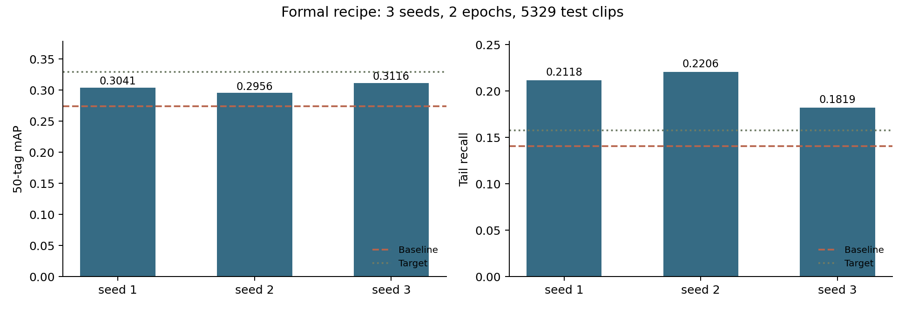
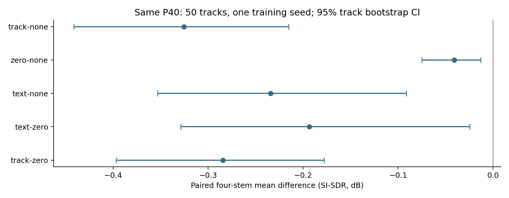

# Semantic-Aware Music Separation & Understanding

**语义感知多轨音源分离与音乐理解**：将四轨分离、音乐标签、文字检索和创作辅助接成一个可运行的 Gradio 系统，并研究 CLAP → Qwen2 LoRA 与 FiLM 条件分离。

本仓库包含最终演示工程、研究脚本、脱敏实验结果和复现说明。最新结论以本页及[实验结果](docs/results.md)为准；`docs/w2_*.md` 与根目录编号脚本保留阶段研究记录。

## 功能

- 预训练 HTDemucs 分离人声、鼓、贝斯和其他伴奏。
- 官方 LAION CLAP 为全曲及逐轨提供候选标签。
- 文字检索 Top 5 音乐，当前优先使用英文描述。
- 根据逐轨候选标签提供条件式混音建议，以及经校验的文案、场景草稿。
- 保留音频向量投影至 Qwen2 的 LoRA 训练及条件分离研究实现。

## 最终结果

| 实验 | 结果 | 解释边界 |
| --- | --- | --- |
| MTT 50 类、5,329 条测试音频 | 零样本 mAP 0.274434 → 三种子 **0.303768 ± 0.007964** | 相对提高 **10.69%**；±为样本标准差 |
| 14 类长尾召回 | 0.140800 → **0.204771 ± 0.020254** | 相对提高 **45.43%**；精确双侧 p=0.25，Holm p=0.50 |
| 正式 LoRA 训练 | 18,608 条指令、2 轮、batch 8、seed 1/2/3 | P40 峰值 **12.11–12.56 GB**；历史缩小配方的 7.04 GB 单独报告 |
| 条件分离，50 首完整测试曲目 | 音频／全零／固定文本相对无条件微调分别 **−0.3252／−0.0409／−0.2343 dB** | SI-SDR；单训练种子、300 步，没有正向增益 |
| 英文自由查询，弱标签判分 | 10 组可评价查询：P@5 **28%**、Hit@5 **90%** | 全部 12 组另报 23.33%、75%；中文直接输入均为 0 |
| 检索人工试听 | 英文／中文 2 分阈值 P@5：**98.33%／1.67%** | 12 组固定查询、120 条候选、单评审；2 分表示“大部分相关” |



图中目标线是实验预设目标，不代表显著性阈值。mAP 未达到相对提高 20% 的预设目标；长尾提升的点估计不能作为总体稳定性或统计显著性的证明。



条件实验只支持当前模型、注入点和训练预算下的结论。固定文本为所有曲目共用的通用句子，尚未验证目标乐器控制或逐曲文本条件。

## 快速开始

安装 Python 3.10+、FFmpeg，并先按[资产准备说明](docs/assets.md)准备模型、音频及索引。仓库不包含原始音频和模型权重，安装依赖后仍需准备资产。

```bash
python -m venv .venv
# Windows: .venv\Scripts\activate
# Linux/macOS: source .venv/bin/activate
python -m pip install -r demo/requirements.txt
python demo/app.py --assets /path/to/assets --device cpu
```

浏览器打开 `http://127.0.0.1:7860`。默认仅本机访问；CPU 首次加载和分离需要等待，结果写入 `demo/outputs/`。

CUDA 机器先准备与驱动匹配的 PyTorch 环境。最终训练使用 `demo/requirements-train.txt`，详见[演示与复现指南](demo/README.md)。根目录 `requirements.txt` 保留历史研究依赖，最终演示使用 `demo/requirements.txt`。

## 无需模型的统计复核

```bash
python -m pip install numpy==1.26.4 pandas==2.2.2
python demo/final_statistics.py --self-check
python demo/final_statistics.py --lora benchmarks/lora --conditioned benchmarks/conditioned --output demo/outputs/statistics
```

匿名曲目编号保持跨组一致，可复算配对条件实验。LoRA 汇总统计从随附三种子指标复算；重新计算逐音频 AP 或重新训练，需要自行准备数据、缓存和模型。

## 目录

| 位置 | 内容 |
| --- | --- |
| `demo/` | 最终 Gradio 工程、评测、统计检查与正式训练脚本 |
| `benchmarks/` | 三种子指标、匿名逐曲分数、统计方案及检索汇总 |
| `docs/results.md` | 方法、划分、评测口径、负结果与局限 |
| `docs/assets.md` | 模型、数据与缓存准备说明 |
| `docs/publication.md` | 发布范围、脱敏与验证说明 |
| `scripts/`、`src/`、`configs/` | 早期基线、长尾研究与模型模块 |

## 使用限制

CLAP 相似度是排序分数，不是标签概率。全曲概括来自候选标签，不等于自由音频描述。音频 LoRA 自由描述质量不足，未作为可靠功能接入演示。创作助手接收标签证据，混音建议尚未实际应用到音频。中文直接检索、专业音质评价、实际混音改善与全新系统安装仍需验证。

工程和文档包含生成式 AI 辅助编写内容；实验结论以保存的运行记录为依据，AI 生成文本不能替代实验或试听证据。

## 上游项目与数据

[Demucs](https://github.com/facebookresearch/demucs) · [LAION CLAP](https://github.com/LAION-AI/CLAP) · [Qwen2](https://huggingface.co/Qwen/Qwen2-1.5B-Instruct) · [MUSDB18-HQ](https://doi.org/10.5281/zenodo.3338373) · [LP-MusicCaps](https://github.com/seungheondoh/LP-MusicCaps)

请向发布方获取数据、模型及依赖，并遵守各自许可。本次整理未新增开源许可。
